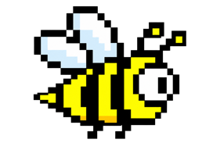

# Flappy Bee

A small browser game inspired by the classic side-scrolling flappy genre. Guide a pixel-art bee through the pipes while the clouds and ground scroll across the scene.



## Features

- Reactive game logic powered by RxJS
- SVG graphics and animated scenery
- Keyboard controls, collision detection, scoring, and lives
- Pause, restart, and previous-path ghost replays
- Pipe layouts loaded from CSV

## Built with

- TypeScript
- RxJS
- SVG and CSS
- Vite
- Vitest

## Run locally

Install [Node.js](https://nodejs.org/), then run:

```bash
npm install
npm run dev
```

Open the local URL printed in the terminal.

## Controls

- Click the page to start
- Press `Space` to flap
- Press `Escape` to pause or resume
- Press `R` to restart after game over

## Other commands

```bash
npm run test:run
npm run build
npm run generate-pipes
```
